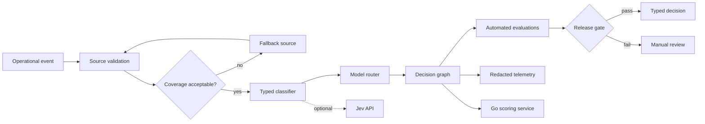

# Production Data and AI Decision Platform

A public, production-oriented reference implementation for turning imperfect operational data into typed, evaluated decisions. It demonstrates the engineering patterns I use across data platforms and AI systems: explicit contracts, source fallbacks, graph execution, model routing, evaluation gates, redacted telemetry, and fail-closed publication.

The domain and fixtures are synthetic. The repository contains no employer code, private financial data, credentials, or proprietary decision rules.

## What this demonstrates

- Python control plane with FastAPI and Prefect
- Go scoring service for a small latency-sensitive boundary
- Typed classification with a deterministic local implementation and optional Jev adapter
- Graph-based execution with visible state transitions
- Cost-aware model routing
- Automated evaluation before a decision is released
- Primary and fallback data sources
- Redacted structured telemetry and Prometheus metrics
- Docker Compose, tests, linting, type checking, and CI

## Architecture



The platform separates fuzzy judgment from operational authority. A classifier or language model may recommend an action, but only deterministic contracts and evaluation gates can release it.

## Run it

```bash
docker compose up --build
```

Then submit the synthetic example:

```bash
curl -s http://localhost:8000/v1/decisions \
  -H 'content-type: application/json' \
  --data @data/synthetic_opportunity.json
```

The API is available at `http://localhost:8000`, its OpenAPI documentation at `/docs`, Prometheus metrics at `/metrics`, and the Go scoring service at `http://localhost:8081/health`.

## Test and verify

All project checks run inside Docker:

```bash
docker compose run --rm api pytest -q
docker compose run --rm api ruff check src tests
docker compose run --rm api mypy src
docker build --target test ./go/scoring
```

Run the reproducible scoring microbenchmark in the same containerized toolchain:

```bash
docker build --no-cache --target benchmark ./go/scoring
```

The benchmark reports nanoseconds per operation and allocations per operation. Results are kept
environment-specific rather than presented as universal production throughput.

## Typed classification

The default classifier is local and deterministic, which keeps the repository runnable without external accounts. Set `JEV_API_KEY` to exercise the hosted adapter. Its output is normalized into the same `TypedDecision` contract, so the rest of the graph does not depend on a particular provider.

## Why Prefect here

The workflows are Python-heavy, dynamic, and frequently executed ad hoc. Prefect keeps orchestration close to the application code and requires less infrastructure for this scale. Airflow would be a stronger choice for a large organization that already operates it, needs a highly centralized scheduler, or manages a broad estate of mostly static DAGs.

## Failure policy

The release gate fails closed when source coverage, classifier confidence, evidence quality, or evaluation score falls below policy. Low-confidence results become review requests; they never silently become actions.

## Security and privacy

- Secrets enter only through environment variables.
- Telemetry redacts configured sensitive keys before export.
- Synthetic fixtures are the only bundled data.
- The API rejects unknown fields and invalid enum values.
- No endpoint executes financial transactions or other external side effects.

See [the architecture guide](docs/architecture.md) and the [decision records](docs/decisions/) for the trade-offs behind the implementation.

## License

MIT
